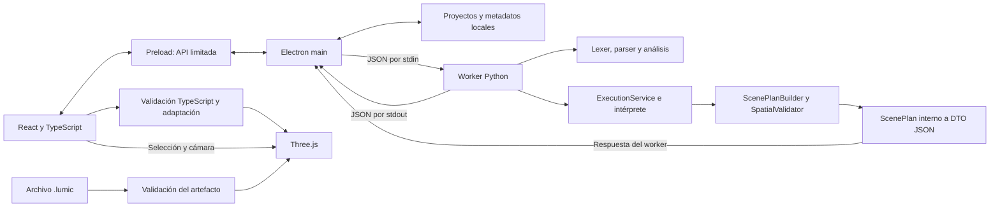

# Arquitectura actual de Estudio Lumi

## Componentes y límites

Estudio Lumi usa Electron como aplicación de escritorio, React y TypeScript para
la interfaz y Three.js para el visor. Python conserva el análisis y la ejecución
del lenguaje. El frontend no implementa un parser, intérprete ni evaluador espacial
alternativo. Vite sirve el frontend durante el desarrollo y genera sus recursos
estáticos para distribución.

La ejecución produce ScenePlan en Python; el worker lo adapta y transporta hasta
el renderer mediante main y preload. TypeScript valida la respuesta antes de
entregarla al visor. La importación `.lumic` es otra entrada al mismo visor.
No se transportan eventos de depuración producidos por Python.

| Capa y rutas desde la raíz | Responsabilidad |
|---|---|
| `apps/desktop/renderer/src/App.tsx`, componentes y hooks | Editor, proyectos, solicitudes, resultados y reproducción de pasos. |
| `renderer/src/services/integration/` dentro de `apps/desktop` | Construir solicitudes, validar respuestas y adaptar diagnósticos al estado del IDE. |
| `apps/desktop/electron/preload.ts`, `main.ts`, `pythonWorker.ts` | Puente IPC, ciclo de vida de ventana/proceso y comunicación con Python. |
| `apps/desktop/electron/workspaces/`, `workspaceIpc.ts` | Acceso autorizado a carpetas, escrituras y metadatos del perfil. |
| `services/compiler_service.py`, `execution_service.py` | Fachadas que reutilizan las API del núcleo; separan analizar de ejecutar. |
| `services/worker.py`, `services/protocol/` | Mensajes JSON, validación y errores de protocolo o infraestructura. |
| `lumi_language/`, `spatial/` | El intérprete evalúa el programa y usa ScenePlanBuilder para acumular valores resueltos; SpatialValidator comprueba el plan. |
| `services/protocol/scene_adapter.py` | Convierte el ScenePlan interno al DTO del visor, sin evaluar expresiones ni modificar el modelo interno. |
| `apps/desktop/renderer/src/components/viewport/` | Geometrías, materiales, cámara, selección y liberación de recursos Three.js. |

## Comunicación y errores

El protocolo `1.0.0` usa una línea JSON UTF-8 por solicitud y respuesta, con
`requestId`, `operation` (`analyze` o `execute`), archivo principal y mapa de fuentes.
Los nombres exactos están en [los modelos Python](../services/protocol/models.py)
y [los tipos TypeScript](../apps/desktop/renderer/src/services/integration/protocol/types.ts).
No se envía el AST al renderer. `stdout` se reserva al protocolo y `stderr` a registros.

Los resultados distinguen `completed`, `failed`, `incomplete` y `blocked`.
Los errores de protocolo o infraestructura usan `status: "error"`; no se convierten
en errores inventados del programa. Los diagnósticos conservan categoría, código,
archivo, línea, columna, descripción y sugerencia opcional. Python no declara una
severidad equivalente a la UI: el adaptador usa `unspecified` y separa el bloqueo
de la operación. Los errores léxicos sin ubicación estructurada se muestran como texto.

`analyze` no ejecuta instrucciones ni genera escena. `execute` llama al intérprete
y puede devolver `result.scenePlan` con `capabilities.scenePlan: true` si termina
correctamente y hay habitaciones. Sin escena, el campo se omite y el adaptador
lo representa como `null`. El análisis puede conservar `analysisStatus: incomplete`
y su limitación espacial aunque la ejecución tenga `status: completed` y escena.
No equivale a validar colisiones o todas las reglas espaciales.

`debugTrace`, `interactiveInput` y `cancellation` permanecen en `false`; los
resultados Python contienen `debugSteps: []` en el IDE. Se correlacionan solicitudes y se descartan
resultados reemplazados para evitar actualizar el proyecto con respuestas antiguas.
El timeout termina el worker; una nueva solicitud puede reiniciarlo. No existe una
sesión interactiva de entrada ni cancelación desde el programa.

## Proyectos, escenas y reproducción

Los proyectos de escritorio son carpetas `.lumi`, sin manifiesto nuevo. El perfil
guarda principal, pestañas e identidades locales; los borradores viven en memoria.
La [guía de almacenamiento](project_storage.md) detalla persistencia, conflictos,
límites, seguridad y falta de portabilidad de metadatos.

`LumicFileService` valida el contenedor antes de entregarlo al visor. El
[candidato `.lumic` v1.0.0](contracts/lumic/v1.0.0/README.md) sigue pendiente de
validación de interoperabilidad. Contenedor, ScenePlan de intercambio, ScenePlan
interno Python, AST y diagnósticos son estructuras diferentes. Consulta la
[guía Python–IDE](lumic_python_handoff.md) para los mapeos todavía pendientes.

Three.js consume ScenePlan de ejecución, escenas de `.lumic` y snapshots importados. Las fábricas
construyen habitaciones, aberturas y muebles, aplican propiedades y permiten
selección. La cámara ortográfica usa OrbitControls; el gestor atiende cambios de
tamaño y libera geometrías, materiales, controles y renderer al desmontar.
Los indicadores de colisión o límites recibidos no constituyen un nuevo validador
espacial. El depurador reproduce eventos importados o de demostración; no controla
el intérprete Python. Navega solo a archivos reconocidos del proyecto y limpia
selecciones o resaltados cuando el paso carece de datos válidos.

La escena runtime comprobada incluye habitaciones, pisos y muebles colocados,
con posiciones y rotaciones absolutas evaluadas por Python. Las cuatro paredes
neutrales son cerramientos visuales derivados de la habitación. Las declaraciones
`pared`, `puerta` y `ventana` carecen de geometría suficiente para el DTO; el
adaptador las rechaza con `SERIALIZATION_ERROR`. También rechaza objetos sin
colocar, aunque el plan interno conserva su posición indefinida. No inventa
coordenadas ni omite esos elementos. Las aberturas de un `.lumic` compatible sí
pueden visualizarse: no demuestra generación desde el lenguaje.

El catálogo de dimensiones de muebles es visual y provisional. Unidades, ámbito
y estabilidad de IDs, pivotes y geometría de aberturas siguen sujetos a acuerdo;
véanse las [decisiones de interoperabilidad](integration/SCENEPLAN_OPEN_DECISIONS.md).

## Desarrollo, distribución y seguridad

| Entorno | Frontend, Python y almacenamiento |
|---|---|
| Electron en desarrollo | Vite local, selección de Python mediante entorno/configuración y proyectos en disco. |
| Navegador con Vite | Compilador mock, escenas de demostración y `localStorage`; no prueba integración Python. |
| Electron instalado | Recursos estáticos en ASAR mediante `lumi-app://ide/index.html`; Python embebido y módulos fuera de ASAR; proyectos en disco. |

El renderer tiene aislamiento de contexto y sandbox, sin Node.js. Preload expone
operaciones concretas; main valida remitentes, mensajes y rutas. Se restringen
navegación, ventanas externas, permisos y acceso fuera del proyecto. No se abre un
servidor HTTP para Python: se inicia un proceso local con argumentos explícitos.
Estas restricciones no equivalen a un sandbox completo del código Python del núcleo.

El paquete Windows x64 usa electron-builder y NSIS por usuario. CPython está fijado
por versión y SHA-256; producción no depende de un Python externo. Los detalles,
dependencias incluidas y pruebas del ejecutable instalado están en
[empaquetado](windows_packaging.md). No hay actualizaciones automáticas configuradas
ni firma de editor de confianza.

La prueba [runtime-scene.integration.mjs](../apps/desktop/tests/runtime-scene.integration.mjs)
se ejecutó con Python real y WebGL en Electron de desarrollo, incluyendo errores
y retirada de la escena anterior. También se comprobaron proyectos e importación
independiente. El instalador existente corresponde a una versión anterior: el
paquete combinado aún no se ha regenerado ni aceptado y falta Windows limpio.

## Decisiones tecnológicas y planteamiento inicial

La propuesta general del [README](../README.md#initial-design-and-project-goals)
describe el objetivo código → escena compilada → visor. Actualmente la ejecución
Python entrega una escena final al visor para el subconjunto soportado; Compilar
realiza análisis y la importación `.lumic` conserva su recorrido independiente.
El prototipo web se reutiliza mediante componentes y servicios, con adaptadores
para procesos y disco en Electron. Las carpetas Python heredadas no son el frontend
empaquetado de esta aplicación.

| Planteamiento inicial | Implementación actual |
|---|---|
| Interfaz Python con PySide6 y visualización con Ursina | Ventana Electron, interfaz React/TypeScript y visor Three.js. |
| Dependencias gráficas Python junto al entorno del lenguaje | El worker usa los módulos Python necesarios para las fachadas; el paquete no instala toda la lista histórica de `requirements.txt`. |
| Código → compilación espacial → escena y depuración | Escena final producida por ejecución Python y verificada en desarrollo; reproducción de eventos importados, sin trazas Python reales. El paquete combinado sigue sin aceptación. |

`requirements.txt` conserva PySide6, Ursina y Panda3D. Su presencia no prueba que
sean el frontend de Electron ni que esas pruebas históricas se hayan ejecutado.
La adopción práctica de otra tecnología y su justificación deben distinguirse de
una eventual aprobación académica formal, que no se documenta aquí como realizada.

Electron permite conservar React y Three.js y proporcionar acceso local mediante
main/preload. TypeScript expresa los contratos de UI, aunque los datos externos
también requieren validación en ejecución. Three.js evita duplicar la representación
del visor existente. Python mantiene una única implementación del lenguaje. La
comunicación por procesos separa sus ciclos de vida sin introducir un servicio de red.
El runtime incluido aumenta el paquete, pero elimina la instalación externa de
Python para el usuario. Estas razones describen la implementación; no atribuyen
aprobación formal de cambios a documentos o personas sin evidencia.
