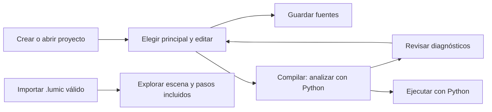

# Manual de usuario de Estudio Lumi

Estudio Lumi permite editar proyectos Lumi, analizarlos y ejecutarlos con Python.
También permite visualizar archivos `.lumic` validados. La compilación espacial y
las trazas reales de Python todavía no están integradas: una habitación escrita en
el editor no genera actualmente una escena 3D.

Este manual describe la aplicación Electron. El frontend abierto directamente en
el navegador usa demostraciones y no sustituye las pruebas con Python real.
Consulta la [instalación en Windows](installation_windows.md) antes de comenzar.

## Orientarse en la interfaz

La barra superior reúne Archivo, Compilar, Ejecutar, Ayuda y Ajustes. El explorador
organiza las fuentes; las pestañas identifican el archivo editado. La consola
presenta resultados y diagnósticos. El visor muestra una escena importada o de
demostración y permite inspeccionarla sin editar el programa.



El recorrido de importación es independiente del recorrido de ejecución. Las
ilustraciones de este manual son diagramas; las capturas auténticas pendientes se
enumeran al final, sin sustituirlas por imágenes simuladas.

## Crear o abrir un proyecto

1. Selecciona **Archivo → Nuevo proyecto...**.
2. Indica el nombre y una carpeta contenedora. Se crea una subcarpeta y una fuente
   `principal.lumi`, marcada como archivo principal.
3. Para continuar un trabajo existente, usa **Archivo → Abrir proyecto... → Abrir
   carpeta del disco** y selecciona la carpeta que contiene las fuentes `.lumi`.
4. Abre las fuentes desde el explorador. En las opciones de un archivo puedes
   establecerlo como principal.

Compilar y Ejecutar usan el **archivo principal**, aunque estés editando otra
pestaña. No se elige el principal por el nombre del archivo al abrir una carpeta
en otra computadora: selecciónalo nuevamente. El IDE descubre subcarpetas sin
reinterpretar las reglas de imports del lenguaje.

Los proyectos anteriores del navegador pueden guardarse como copia en disco desde
Abrir proyecto. La copia no borra el original del almacenamiento del navegador.

## Editar, guardar y gestionar fuentes

Haz clic en una pestaña para activarla. El editor ofrece resaltado de sintaxis y
números de línea; la ayuda de sintaxis se abre desde **Ayuda**. Las plantillas de
habitación insertan texto, no producen geometría ni garantizan semántica espacial.
El menú indica que el formateador Lumi no está disponible.

| Operación | Resultado |
|---|---|
| Archivo → Nuevo archivo .lumi | Crea una fuente dentro del proyecto. |
| Guardar / Ctrl+S | Escribe el archivo actual. |
| Guardar todos los cambios / Ctrl+Shift+S | Escribe los archivos modificados. |
| Guardar archivo como... | Crea y abre una copia dentro del proyecto; conserva el original y el principal. |
| Renombrar desde el explorador | Conserva la identidad y el contenido; requiere ajustar imports afectados manualmente. |
| Archivo → Renombrar proyecto... | Renombra la carpeta y conserva las referencias relativas del IDE. |
| Eliminar archivo o proyecto | Solicita confirmación y mueve a la papelera; eliminar el proyecto incluye toda su carpeta. |

Las pestañas señalan cambios pendientes. Al cerrar una pestaña modificada puedes
guardar, descartar o cancelar. Antes de salir, guarda todos los archivos: la
confirmación de descarte de la ventana no constituye un guardado automático.
Los borradores no son recuperación ante una caída del sistema. La opción **Guardar
espacio de trabajo** llama al guardado de cambios; no exporta un proyecto portable.

No edites simultáneamente los mismos archivos con otra aplicación. Si el IDE
detecta cambios externos, conserva el borrador y comunica el conflicto. Guarda una
copia de respaldo antes de reconciliar contenidos. Guardar todos no es una
transacción: algunas fuentes pueden haberse escrito antes de que otra falle.
Los detalles están en [proyectos y almacenamiento](project_storage.md).

## Analizar y ejecutar

Prueba este programa en el archivo principal:

```lumi
principal {
    mostrar("Hola, Lumi")>>
}
```

1. Guarda el archivo si deseas conservarlo en disco.
2. Pulsa **Compilar** (F5). En Electron esta acción solicita análisis a Python;
   no ejecuta `mostrar` ni genera un `.lumic` automáticamente.
3. Revisa el resultado en la consola y los diagnósticos.
4. Pulsa **Ejecutar Python** (F6). Para este ejemplo, la salida incluye `Hola, Lumi`.

Las solicitudes utilizan los contenidos actuales de los editores, incluidos los
borradores. Un cambio posterior puede dejar el resultado anterior desactualizado;
vuelve a analizar o ejecutar. No interpretes una salida anterior como resultado
de las últimas modificaciones.

| Estado | Cómo interpretarlo |
|---|---|
| Completado | Terminó la operación solicitada; no implica una escena espacial. |
| Fallido | Revisa los diagnósticos o el mensaje de error. |
| Análisis incompleto | Hay una capacidad pendiente, como semántica espacial. No equivale a validar completamente la habitación. |
| Bloqueado | No se pudo iniciar la ejecución con el análisis disponible. |

Por ejemplo, `principal { habitacion sala(5.0, 4.0, 2.7) {} }` es reconocido
sintácticamente, pero el flujo actual informa análisis incompleto y no genera
ScenePlan ni trazas. No intentes corregir ese límite cambiando dimensiones válidas.
No hay entrada interactiva disponible ni depuración en vivo del intérprete.

## Leer diagnósticos y volver al código

El panel muestra categoría, código, descripción, archivo y ubicación cuando esos
datos están disponibles; puede incluir una sugerencia. Usa **Ir al código** o el
doble clic para abrir la fuente exacta y situarte en su línea y columna. Una ruta
que no pertenece al proyecto no se abre como archivo externo.

Para comprobar un diagnóstico de ejecución, reemplaza temporalmente el ejemplo por
`principal { mostrar(4 / 0)>> }` y ejecuta: Python informa `RUN_DIVISION_BY_ZERO`.
Después restaura el programa válido. Los fallos del proceso o del protocolo se
presentan como problemas de infraestructura, no como errores inventados de Lumi.
Algunos errores léxicos llegan como texto sin ubicación estructurada.

## Importar y explorar una escena `.lumic`

1. Selecciona **Archivo → Abrir compilación (.lumic)...** o Ctrl+Shift+O.
2. Elige un artefacto compatible. El IDE valida su estructura antes de visualizarlo.
3. Para una demostración reproducible desde el repositorio, utiliza
   [valid-basic.lumic](contracts/lumic/v1.0.0/examples/valid-basic.lumic).
   Es un fixture, no un resultado del compilador Python actual.
4. Elige una habitación cuando el archivo contenga varias. Haz clic en un mueble
   para seleccionarlo y consultar sus propiedades disponibles.

Arrastra con el botón izquierdo para orbitar, usa la rueda para acercar/alejar y
el botón derecho para desplazar la vista. Los controles permiten enfocar la
habitación o el objeto seleccionado, restablecer la cámara, ajustar zoom, alternar
ejes, cotas y modo alámbrico, cambiar iluminación y maximizar el visor. **Capturar
imagen PNG** descarga una imagen de la vista 3D, no una captura de todo el IDE.
Estos controles cambian la visualización, no las fuentes Lumi.

El visor representa piso, paredes, aberturas y muebles con los datos del artefacto.
No calcula automáticamente la validez espacial del programa. El formato es
[candidato v1.0.0](contracts/lumic/v1.0.0/README.md); la validación estructural no
garantiza que todas sus referencias o relaciones espaciales sean correctas.
Importar una escena tampoco importa sus fuentes al proyecto.

**Exportar compilación (.lumic)...** requiere un resultado compatible exitoso con
habitaciones. El análisis Python actual no lo proporciona; la opción no completa
la generación espacial pendiente.

## Reproducir pasos importados

Importa [valid-debug.lumic](contracts/lumic/v1.0.0/examples/valid-debug.lumic) y abre
el panel de depuración. Sus pasos son fixtures identificados como tales. Usa paso
anterior/siguiente, inicio/final, reproducir/pausar y velocidad 0.5x, 1x o 2x.

Al cambiar de paso se utiliza su snapshot y su entidad, cuando existen. La
navegación al código solo ocurre si `sourceRef` identifica una fuente reconocida
del proyecto. Sin las fuentes correspondientes puede verse la escena sin abrir
código; no se crean archivos a partir del evento. Un paso incompleto no debe
conservar la selección o el resaltado del paso anterior.

La reproducción no pausa ni inspecciona un proceso Python. Los marcadores locales
del editor no son puntos de interrupción conectados al intérprete. Si no hay pasos,
los controles permanecen sin una secuencia que reproducir.

## Problemas frecuentes

| Problema | Acción |
|---|---|
| Compilo una habitación y el visor está vacío | La generación espacial Python está pendiente; importa un `.lumic` válido para probar el visor por separado. |
| Ejecuto otra pestaña y no cambia el programa | Comprueba cuál es el archivo principal y los cambios pendientes del proyecto. |
| No puedo guardar o renombrar | Revisa permisos, nombres, conflictos externos y ubicación. Renombrar requiere un sistema compatible con enlaces duros, como NTFS. |
| El import dejó de funcionar tras renombrar | Ajusta manualmente la ruta usada por el código; el IDE no reescribe imports. |
| Un `.lumic` se rechaza | Revisa el error y el contrato candidato; no renombres un AST o un JSON del worker como `.lumic`. |
| No se abre el código de un paso | Abre el proyecto con las fuentes y referencias relativas correspondientes. El artefacto no contiene necesariamente esas fuentes. |
| Error al inicializar WebGL | Revisa controlador gráfico y disponibilidad de WebGL; conserva las fuentes y prueba otra configuración gráfica del equipo. |
| Falta el runtime Python instalado | Reinstala el paquete. No hay sustitución automática por una demostración. |
| Una operación tarda demasiado | El timeout puede finalizar el worker; una nueva solicitud permite reiniciarlo. Revisa el programa y el mensaje antes de repetir. |
| Cambié de computadora y perdí pestañas o principal | Reabre la carpeta y selecciona el principal; los metadatos son locales. |

## Capturas auténticas por incorporar

| Figura | Vista y pie previsto |
|---|---|
| 1 | Inicio de Estudio Lumi instalado, con el indicador de Python real y las zonas de trabajo. |
| 2 | Nuevo proyecto y selección de carpeta, sin rutas personales visibles. |
| 3 | Explorador con dos fuentes, principal señalado y pestaña con cambios pendientes. |
| 4 | Ejecución del ejemplo `Hola, Lumi`, con fuente y salida visibles. |
| 5 | Diagnóstico de división por cero y navegación al código. |
| 6 | Importación de `valid-basic.lumic`, selección y controles; rotular «fixture importado». |
| 7 | Pasos de `valid-debug.lumic`, snapshot y aviso de reproducción; rotular «fixture importado». |
| 8 | Aplicación en la lista de Windows para desinstalar y conservación de un proyecto externo. |

Las figuras están pendientes de selección y revisión visual. Deben capturarse en
la aplicación real con el mismo estado documentado, sin datos personales ni
afirmaciones de generación espacial. Para la presentación consulta el
[recorrido demostrativo](ide_presentation.md).
